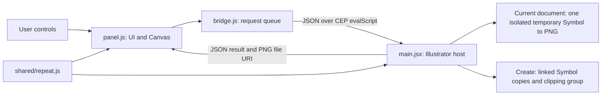

# Seamless Maker

An offline, compact Illustrator CEP panel for previewing and generating clipped, linked symbol repeats. All panel text is English. This release targets Illustrator 2022–2023 (26.x–27.x), CEP 11, on Windows. Actual host acceptance remains pending; the manifest range is an installation target, not certification.

## What this extension does

Seamless Maker turns one selected Illustrator **Symbol instance** into a repeat tile. It is useful for building repeated motifs for fabric, wallpaper, packaging backgrounds and similar artwork: configure the spacing and tilted row/column directions, inspect a color preview, then generate the linked vector instances when the layout is ready.

The tile can use the active artboard dimensions or custom dimensions. **All Sides** produces a rectangular tile that repeats horizontally and vertically. **Top–Bottom** repeats vertically while allowing fixed horizontal spacing; its left and right edges are cropped normally. Tilted layouts calculate which row/column indices must meet across opposite edges, so the matching symbol does not need to stay in the same column or row.

The generated result is a new layer containing a **Seamless Repeat** clipping group. Inside it, copies remain linked to the Symbol definition and a **Tile Clip** rectangle crops the artwork to the exact tile size. Editing that Symbol definition updates its generated instances. The selected source instance remains in place. The output is ordinary Illustrator artwork that can be edited, moved, duplicated or exported after creation.

This release handles one Symbol at a time. It does not create a Pattern Swatch, convert ordinary artwork into Symbols automatically, randomize motifs, or follow a Blend/path. Preview zoom is a viewing control; source size and orientation are set in Illustrator itself.

## Install

1. Close Illustrator, extract `SeamlessMaker-1.1.10-Windows.zip` completely, and double-click `Install.cmd`.
2. The installer copies the panel to `%APPDATA%\Adobe\CEP\extensions\com.seamlessmaker.panel`. No administrator access is required. It does not change any Adobe security settings.
3. The **Signed.zip** contains the verified signed extension including `META-INF`, plus a signed `.zxp` for CEP-compatible ZXP installers. Preserve all extension files unchanged. No private certificate or password is included. The older ZIP without `Signed` in its name remains an unsigned development build. The installer backs up the existing Seamless Maker folder to `%TEMP%` and replaces it completely to avoid stale files invalidating the signature.
4. For deliberate developer testing, Adobe documents `PlayerDebugMode` under the current user's `Software\Adobe\CSXS.<runtime version>` registry key. Setting it to the string `1` permits unsigned extensions for that runtime generally, not just Seamless Maker. Use only the specific runtime used by your Illustrator, and record the original value before changing it. The installer does **not** make this change. See [Adobe's CEP cookbook](https://github.com/Adobe-CEP/CEP-Resources/blob/master/CEP_8.x/Documentation/CEP%208.0%20HTML%20Extension%20Cookbook.md).
5. Restart Illustrator and open **Window > Extensions > Seamless Maker**, or **Window > Extensions (Legacy) > Seamless Maker**.

This is a CEP extension, not a native `.aip` plug-in. It does not require a subscription service, network connection, or Node.js at runtime.

The compact UI targets one page at **400 × 620 px**, with four columns of numeric settings and Create alongside H. Steps / V. Steps. Scale, Rotation and Offset controls are removed, and the footer is removed. The manifest requests the same initial, minimum and maximum dimensions to constrain resizing. Illustrator may still control the geometry of a docked panel group; floating the panel provides the best chance of respecting these dimensions. See [Adobe's CEP sizing documentation](https://github.com/Adobe-CEP/CEP-Resources/blob/master/CEP_12.x/Documentation/CEP%2012%20HTML%20Extension%20Cookbook.md). Hover over a long status or seam-compensation message to read its complete text.

## Use

1. Open a document. Select exactly one **Symbol instance** on the canvas. Convert ordinary artwork using the Symbols panel first if needed.
2. Click **Use Selected Symbol**. The preview captures an isolated temporary symbol copy in the current document. It opens no document or tab and removes the copy before refreshing the view. Original artwork, layers, selection and saved state are restored.
3. Choose **Active Artboard**, or enter **Custom** dimensions. Custom tiles use the active artboard's top-left corner, without resizing the artboard.
4. Choose **All Sides** for a rectangular seamless tile, or **Top–Bottom** for vertical repeats only. Top–Bottom clips the left/right edges normally; those edges are not guaranteed to match.
5. Choose **Tilted Lattice** for independent row/column directions and exact seam compensation. In **All Sides**, set Horizontal/Vertical Steps, integer **Row Tilt (Count)**, **Row Cycles (Unit)** and **Column Tilt (Count)**; Horizontal X/Y and Vertical X/Y are calculated. In **Top–Bottom**, set fixed **Horizontal X/Y**, Vertical Steps and Column Tilt; Horizontal Steps is disabled. Tilt values are compensation counts, not degrees. The readout identifies the matching column/row deltas across each seam. **Grid** and **Staggered Rows** remain available with their original Steps behavior.
6. The selected instance's size and orientation are preserved. To change them, edit the source instance in Illustrator and click **Use Selected Symbol** again. The panel adds no scale, rotation or offset adjustment.
7. Inspect **Tile** or **Repeat Preview**. Repeat Preview shows 3 × 3 tiles for All Sides and 1 × 3 for Top–Bottom. Choose a white or transparent/checkerboard background. Use **Fit**, **50%** or **100%** to zoom; drag with the left mouse button when the preview exceeds its frame. Fit shows the complete tile or repeat array. At 100%, one document point maps to one CSS pixel (72-point reference), independent of screen density; this is not a physical-size calibration. Zoom affects only the preview, never generated artwork.
8. Click **Create**. A new layer contains a **Seamless Repeat** clipping group and a **Tile Clip** rectangle. Instances remain linked to the original symbol definition; the source instance is preserved.

Layout settings reuse the cached symbol image. The panel waits approximately 150 ms after input. Zoom/pan redraws locally without host calls, using viewport clipping at 50% and 100% rather than allocating a full-size artboard canvas. **Refresh** re-reads the active artboard and renders the current symbol appearance; use it after editing the symbol definition, changing document color settings, or changing artboards. Use **Use Selected Symbol** to change the source or switch documents.

Tilted Lattice uses a continuous infinite row/column lattice. It compensates column indices at top/bottom and row indices at left/right, preserving straight tilted axes after clipping. Top–Bottom width crops the fixed spacing; changing width does not stretch it. All Sides derives spacing from tile dimensions so both periods close exactly. See [lattice formulas and worked example](docs/LATTICE.md).

Grid/Staggered Rows repeat their finite base positions by the full tile period; odd numbers of staggered rows are valid. Their offsets wrap vertically in both modes and horizontally in All Sides; Top–Bottom horizontal offset can move their finite columns out of the tile. Tilted Lattice offsets move its infinite lattice phase. Overlap follows a deterministic order shared by preview and output. Bounds culling retains only instances intersecting the tile plus a 1 pt margin. Oversized symbols can require several periods of copies.

## Limits and troubleshooting

- Steps must be positive integers; dimensions and Scale must be positive finite values. Tiles and transformed symbol bounds are capped at 16,383 pt per dimension for older Illustrator compatibility.
- Over 2,000 instances shows a performance warning; over 10,000 disables creation. All Sides lattice density is Horizontal Steps × Vertical Steps × Row Cycles. Excessive density and pathological tilt scans are rejected before expensive allocation. Top–Bottom counts depend on fixed spacing and the crop dimensions.
- Preview is a transparent PNG targeting 2,048 px on the longest side; large symbols can exceed that target because imageCapture requires at least 72 PPI. Color/transparency come from Illustrator rendering, but this is not a proof of CMYK print output. High zoom, spot colors, document effects and artwork compositing can differ from a raster preview.
- The source's instance appearance is preserved. Appearance inherited from an enclosing group/layer is not included; select a standalone symbol instance for matching output. External blend interactions, effects outside Illustrator's reported visible bounds, and symbols with no measurable area are outside the preview guarantee.
- Creation revalidates the document, artboard, source bounds/opacity/blending and preview settings. If they change, refresh first. SymbolItem does not expose a transform matrix; if you change the source's orientation or definition without changing its bounds, click Refresh to update the image.
- A failed creation removes only the new output layer and restores the old selection/layer. A successful repeat can be removed by deleting its new layer; the extension does not guarantee a single Illustrator undo step.
- An empty panel or missing menu usually means Illustrator was not restarted, the ZIP was not fully extracted, or unsigned extensions are not enabled for that host runtime. Version 1.0.1 explicitly loads the host from CEP's extension folder when the manifest did not initialize it. If initialization fails, the panel reports the missing file/module or underlying script error. Close/reopen the panel after updating its installed files.
- Preview uses imageCapture in the existing RGB/CMYK document. It temporarily duplicates the Symbol beyond other artwork, removes that copy before redraw, and cleanly restores document saved state, active layer and selection without dangerous app.undo() calls that cause heap corruption crashes. No document is opened or closed; errors include the failing preview stage.

## Uninstall

Close Illustrator and double-click `Uninstall.cmd`. Only this user's Seamless Maker extension folder is removed. No registry values are changed.

Temporary preview PNGs live in `%TEMP%\SeamlessMaker`. The panel deletes its own images when replaced/released; an Illustrator crash can leave files behind. These contain symbol artwork and may be deleted after Illustrator is closed.

## Signed distribution

See [signed release instructions](docs/DISTRIBUTION.md) for rebuilding, private certificate storage and the acceptance checklist.

## Development

No dependencies are required. Run `npm test` with Node.js 20+ and `npm run package` with PowerShell. `extension/shared/repeat.js` is the same ES3 computation used in CEP and ExtendScript. `extension/shared/json.js` supplies a strict, eval-free JSON codec to older host engines. The panel calls `SeamlessMaker.dispatch(JSON-string)` over CEP `evalScript`; see [host protocol](docs/HOST-PROTOCOL.md).

See [validation](docs/VALIDATION.md) for tested environments and the host acceptance checklist. Installation on a machine is not proof of validation on that Illustrator version. [Rotary's main.js](https://github.com/samabogbog/Rotary/blob/main/main.js) was reviewed for its calc2/calc4 spacing and compensation formulas. The implementation uses an ES3 bounds-culling generator and shared preview/output calculation; no Rotary source code is bundled.

## Source structure

```text
seamless-maker/
├── extension/                    Installed runtime files
│   ├── CSXS/manifest.xml         CEP identity, host range and panel geometry
│   ├── index.html                English panel markup and control IDs
│   ├── css/panel.css             Compact dark theme and four-column layout
│   ├── js/
│   │   ├── panel.js              UI state, input conversion, Canvas preview, zoom/pan
│   │   └── bridge.js             Serialized CEP calls and host bootstrap/version check
│   ├── host/main.jsx             Illustrator session, PNG rendering and vector creation
│   └── shared/
│       ├── repeat.js             ES3 validation, lattice vectors, culling and positions
│       └── json.js               Strict JSON codec for legacy ExtendScript
├── install/
│   ├── Install.ps1               Copies this user's extension runtime files
│   └── Uninstall.ps1             Removes this user's extension installation
├── Install.cmd / Uninstall.cmd   Double-click entry points for the PowerShell scripts
├── scripts/
│   ├── run-tests.js              Runs the Node regression suite in one process
│   └── package.ps1               Builds the Windows distribution ZIP
├── tests/
│   ├── *.test.js                 Calculation, bridge, simulated host and panel checks
│   └── illustrator-smoke.jsx     Standalone checks inside actual Illustrator
├── docs/
│   ├── HOST-PROTOCOL.md           Request/response fields and coordinate conventions
│   ├── LATTICE.md                 Repeat formulas and matching-index examples
│   └── VALIDATION.md              Test status and actual-host acceptance checklist
├── package.json                  Version and development commands; no dependencies
├── README.md                     Product, installation and architecture guide
├── dist/                         Generated ZIP packages
└── artifacts/                    Local test reports and verification outputs
```

The Windows ZIP contains `extension/`, installation scripts, README, documentation and the standalone Illustrator smoke script. It is a distribution package rather than a complete development checkout: the automated Node tests and development scripts remain in the source directory. Run development commands from that directory.

## Architecture

The extension has two JavaScript runtimes. The **CEP panel** runs HTML/CSS/JavaScript in Illustrator's embedded browser. The **ExtendScript host** runs inside Illustrator and accesses its native document, Symbol and export APIs. They communicate using JSON over CEP's `evalScript`; there is no web server, cloud backend or network service.



### Runtime responsibilities

| Component | Responsibility |
| --- | --- |
| `index.html` / `panel.css` | Define the visible controls, compact layout and appearance. They contain no repeat calculation. |
| `panel.js` | Own the selected-source token, prepared snapshot, cached image, input revision and viewing state. Convert display units to points, debounce input, ignore stale responses, enable Create only when ready, and draw the preview. |
| `bridge.js` | Queue host requests so only one runs at a time. Resolve the extension's absolute path, load a missing/outdated host namespace, escape the JSON payload and decode host errors. |
| `main.jsx` | Validate the selected Symbol and document, keep the source session, render one Symbol through Illustrator, measure native bounds, revalidate the prepared snapshot, create vector copies and clean up its own files/output. |
| `shared/repeat.js` | Calculate the same positions in both runtimes. Validate inputs, derive the lattice basis and seam compensation, cull against transformed bounds, and enforce allocation limits. It has no DOM or Illustrator API dependency. |
| `shared/json.js` | Provide strict JSON parsing/serialization where the old ExtendScript engine lacks native JSON. Request data is parsed as data, not evaluated as executable code. |

The host and shared modules use ES3 syntax. The browser code also avoids modern web APIs so the intended legacy CEP runtime can load it. Node.js is used only for development tests; PowerShell is used for packaging and installation.

### Preview and creation flow

1. **Inspect:** on opening the panel, `inspect` reads the current artboard. It does not create artwork.
2. **Capture:** Use Selected Symbol sends `capture`. The host requires exactly one SymbolItem, retains references to that instance and its document, and returns a `sourceToken`. Capturing a new source replaces the previous session and releases its cached PNG files.
3. **Prepare:** after approximately 150 ms without another input change, the panel sends `prepare` with the source token and point-based settings. The host resolves active-artboard dimensions and renders a PNG only when needed or when Refresh requests it. One native `doc.visibleBounds` query, combined with artboard/source bounds, locates a region outside all artwork without enumerating pageItems. Rendering duplicates one Symbol into that region, measures its transformed bounds, captures a transparent PNG, then directly removes the temporary layer. No Undo/Redo is invoked. The current UI sends neutral transform values: 100% scale, 0° additional rotation and zero offsets. Cleanup failure invalidates the prepared snapshot, blocks that session, and does not mark the modified document as saved.
4. **Show:** the response contains the resolved settings, measured footprint, PNG URI, instance count and `previewToken`. The panel runs the shared calculation again and checks that its count agrees with the host. It loads the PNG and draws the positions into Canvas. Input revisions prevent an earlier response from replacing a newer preview.
5. **Create:** the panel sends the prepared settings and tokens, not a client-generated position array. The host checks the document, source fingerprint, artboard and settings against the prepared snapshot, then recalculates positions independently. It duplicates the source into its own new layer, places every instance by its transformed visible-bounds center, and adds the exact clipping rectangle. If creation fails, it removes only that new output layer and restores the previous selection/active layer.
6. **Release:** closing the panel requests `release` to discard the source reference and session-owned PNG files. A crash can interrupt this cleanup; remaining preview files are described under Uninstall above.

The source fingerprint tracks its name, bounds, opacity and blending mode, with optional matrix information where supported. It cannot detect every edit inside a Symbol definition that leaves these values unchanged, so **Refresh** remains necessary after those edits. Host state exists only for the current Illustrator session; it is not a saved project format.

### Shared geometry and rendering

All geometry uses **points** internally, regardless of whether the panel displays mm, cm, in or pt. Positions are tile-local with X increasing rightward and Y increasing downward. The host maps each center to Illustrator's document coordinates as `artboardLeft + x` and `artboardTop - y`, and restores the prior coordinate-system setting after dispatch.

For Tilted Lattice, each center has the form `origin + column * horizontalVector + row * verticalVector`. Integer seam-compensation translations make the required tile periods exact. The generator finds the rows/columns intersecting the tile expanded by half the transformed Symbol bounds and a 1 pt margin. Oversized Symbols may therefore need several surrounding periods, while objects outside that expanded region are omitted. Grid and Staggered Rows use their original finite-position repetition. Full formulas are in [LATTICE.md](docs/LATTICE.md).

The host measures the Symbol after native transformations, so culling uses its actual reported footprint rather than an assumed rectangle rotated in browser code. Both runtimes use the same position and stacking order. This also preserves the order of overlapping translucent motifs across a seamless edge.

Only the individual Symbol is a raster image in the preview; generated output remains linked vector SymbolItems. At **Fit**, the panel draws one small clipped tile canvas and reuses it for the repeat view. At **50% / 100%**, it draws only visible tiles and Symbol images into the viewport with clipping, avoiding an artboard-sized canvas allocation. Zoom and bounded dragging never call the host or change output settings.

### Where to make changes

- **Controls, layout or preview interaction:** update `index.html`, `panel.css` and `panel.js` together; keep control IDs consistent with the panel's element list.
- **Spacing, tilts, seam compensation or culling:** update `shared/repeat.js` and verify the geometry checks in `repeat.test.js` / `lattice.test.js`. Preview and creation must keep using this shared module.
- **Illustrator selection, rendering or output behavior:** update `host/main.jsx` and the host checks. A mock pass needs actual Illustrator smoke/visual checks before claiming host compatibility.
- **Request fields or errors:** update the bridge/host as needed and [HOST-PROTOCOL.md](docs/HOST-PROTOCOL.md); do not trust client-provided counts or positions for creation.
- **Runtime releases:** synchronize the version in `package.json`, the CEP manifest, panel header, bridge host-version check and host namespace, then rebuild the ZIP. Documentation-only edits do not require a runtime version change.

The automated suite verifies calculation and simulated transport/host/UI behavior. The standalone Illustrator script and visual checklist cover APIs, color rendering, document cleanup, clipping and actual CEP interactions. See [VALIDATION.md](docs/VALIDATION.md) for the current distinction between automated passes, user-confirmed behavior and hosts that still need testing.

## 1.1.0 changes

- Added Tilted Lattice with fixed Top–Bottom spacing and derived All Sides spacing, based on Rotary's formulas.
- Added independent signed row/column tilt counts, Row Cycles, vector readouts, and matching seam-index compensation. Symbol Rotation remains independent.
- Replaced finite-grid wrapping for this layout with an infinite lattice scan that generates only intersecting symbols and preserves overlap order across seams.
- Added regression checks for reference formulas, the supplied col1,row3 → col3,row11 example, positive/negative tilt, multi-cycle density, oversized footprints, clipping, symbol linkage, panel mode switching and measurement conversion.

## 1.1.1 UI changes

- Four columns for numeric settings, with a compact preview and spacing to target one page at 400 × 620 px.
- Removed the footer and moved Create into the settings beside Offset X/Y. Status and error messages remain visible below the controls, with complete text in hover tooltips.
- Set identical manifest Size, MinSize and MaxSize constraints. Docked geometry remains controlled by Illustrator.

## 1.1.2 UI changes

- Removed Scale, Rotation and Offset X/Y controls. The panel sends neutral transform values while preserving the source instance's existing appearance and transform.
- Reordered tilt fields to Row Tilt, Column Tilt, Row Cycles.
- Added Fit / 50% / 100% preview zoom, bounded mouse dragging, and viewport-only rendering for fixed zoom levels. Switching zoom/view recenters the image; changing display units does not change zoom scale. Release or window blur ends a drag.

## 1.1.3 background preview (superseded by 1.1.5)

- Replaced visible scratch-document creation with hidden background-document creation. Preview export no longer requests redraw or activates the scratch document.
- Uses matching RGB/CMYK startup presets and hidden document closure. Existing document artwork, layer visibility, artboards and selection are untouched during preview.
- Reports unsupported background rendering or incompatible presets instead of falling back to a visible document.
- Regression checks cover no visible document creation/redraw/activation, original document preservation, RGB/CMYK selection, modern hidden creation, export-failure cleanup and unsupported-host handling. Actual host validation of the hidden APIs is still required.

## 1.0.1 fixes

- Fixed `SeamlessMaker is undefined`: CEP dispatch now ensures the host is initialized from an absolute extension path and calls the namespace through `$.global`. Shared modules explicitly attach to the ExtendScript global object.
- Host version checking reloads an outdated namespace once, while retaining the source session between normal calls.
- Bootstrap failures report their actual error, including missing files and script line numbers.
- Steps, Scale and Rotation now wrap into two compact rows instead of allowing native number fields to overflow their four-column row.

## 1.0.2 fixes

- Fixed valid SymbolItems being rejected as unavailable: the source fingerprint no longer requires the unsupported SymbolItem `matrix` property. Copies preserve native transforms using Illustrator's duplicate/resize/rotate APIs.
- Source-read errors now retain the underlying error message instead of treating every failure as a missing/deleted symbol.
- Host mocks now omit the public matrix property by default, matching Illustrator's SymbolItem API. Regression tests cover absent and throwing matrix accessors and the preview-to-create flow.


## 1.1.5 preview document restoration

- Avoids NoUI documents entirely after reproducing invalid source references on Illustrator 26.5.0.
- Uses an ordinary scratch document, closes without saving, and restores Application.activeDocument.
- Temporary preview tabs may appear briefly; source artwork is untouched.


## 1.1.6 preview without document switching

Preview uses Document.imageCapture in the current document. A temporary copy is positioned beyond all existing artwork; no original layer is hidden, and the view refreshes only before preparation and after cleanup. The preview transaction is undone to retain saved status and previous user Undo entries. This transaction can clear an existing Redo branch. Artboards, original bounds, selected objects and layer visibility/locks are retained. Very large symbols may exceed the 2048-pixel target because imageCapture requires at least 72 PPI; the 16383-point canvas limit still applies. An unavailable isolated canvas region produces an error rather than opening another document.

## Pattern presets (1.1.7)

Use **Export JSON** to save the current pattern settings, then **Import JSON** to restore them for the selected Symbol or load them before selecting a Symbol. Presets contain tile dimensions, Size Source, units, repeat mode, layout, step counts, row/column tilt, row cycles, horizontal spacing and preview background. They contain no Symbol artwork or document references. Active Artboard presets follow the current document artboard; choose Custom before exporting when the exact tile dimensions should be reused. Dimensions are stored in points and displayed in the saved units. Import validates the complete file before applying it and refreshes an already loaded Symbol preview. Unsupported versions, invalid JSON and invalid settings leave the previous controls intact.

The preview background now defaults to White. Transparent remains selectable. Restart Illustrator after installing this update so the new buttons and default appear. An example preset is included at docs/example-pattern-preset.json.
 
## 1.1.8 Preview layout, icon controls & outline removal

- **Balanced preview aspect ratio**: Moved the preview canvas to the left side and toolbar controls to the right column, increasing canvas height from 140 px to 165 px and reducing width from 380 px to ~344 px. The resulting ~2:1 proportion eliminates the overly wide/short letterbox appearance and provides a much more square-like view of repeat tiles.
- **Pure SVG icon buttons**: Replaced all preview toolbar text buttons (`Tile`, `Repeat Preview`, `Fit`, `50%`, `100%`) and dropdown with clean, compact SVG icon buttons without text (`tileView`, `repeatView`, `zoomFit`, `zoom50`, `zoom100`, and `bgToggle`).
- **Complete outline removal**: Set all outline and focus-box-shadow effects to `none` across the entire panel (`outline: none !important; box-shadow: none !important;`), ensuring no distracting focus borders appear when clicking buttons or inputs.
- **Reverse Pattern Matcher**: Integrated 4-coordinate vector solver (`Horizontal X`, `Horizontal Y`, `Vertical X`, `Vertical Y`) with independent Repeat Mode selection and ultra-compact zero-scroll layout.
 
## 1.1.9 Crash fix & performance boost
 
- **Eliminated Illustrator crashes (Heap Corruption & Access Violation)**: Removed unsafe `app.undo()` call immediately after `previewLayer.remove()`. Restores document saved state cleanly via `doc.saved = wasSaved` without mutating the undo manager or leaving dangling pointer references in C++ memory.
- **Ultra-fast symbol capture on complex files (O(N²) -> O(1))**: Replaced recursive `doc.pageItems` full-document scan with fast artboard and top-level layer boundary checks. Documents with tens of thousands of vector objects and dozens of layers now capture in milliseconds instead of freezing Illustrator for 10–30 seconds.
